# TaskFlow — AWS Cloud & DevOps Automation Project

**A hands-on Cloud and DevOps portfolio project demonstrating Infrastructure as Code, webhook-triggered CI/CD, containerized deployment, and application observability on AWS.**

[](https://www.python.org/)
[](https://fastapi.tiangolo.com/)
[](https://www.docker.com/)
[](https://www.terraform.io/)
[](https://www.jenkins.io/)
[](https://prometheus.io/)

---

## Table of Contents

- [Overview](#overview)
- [Screenshots](#screenshots)
- [Architecture](#architecture)
- [Technology Stack](#technology-stack)
- [Application Features](#application-features)
- [API Endpoints](#api-endpoints)
- [API Usage Examples](#api-usage-examples)
- [AWS Infrastructure with Terraform](#aws-infrastructure-with-terraform)
- [CI/CD with Jenkins and GitHub Webhooks](#cicd-with-jenkins-and-github-webhooks)
- [Docker and Docker Compose](#docker-and-docker-compose)
- [Monitoring and Observability](#monitoring-and-observability)
- [Testing](#testing)
- [Run Locally with Docker Compose](#run-locally-with-docker-compose)
- [AI-Assisted Engineering](#ai-assisted-engineering)
- [Repository Structure](#repository-structure)
- [Security Notes and Current Limitations](#security-notes-and-current-limitations)
- [Potential Next Improvements](#potential-next-improvements)
- [Author](#author)

---

## Overview

TaskFlow is a task-management web application built with **FastAPI and PostgreSQL** and used as the workload for a practical AWS Cloud/DevOps implementation. The project brings together two separately managed EC2 environments, Terraform-based infrastructure provisioning, GitHub webhook integration with Jenkins, Docker-based application services, automated tests, and Prometheus/Grafana monitoring.

The infrastructure is intentionally split across two EC2 instances:

- **Jenkins EC2:** hosts the Jenkins controller and receives GitHub webhook events to trigger the pipeline.
- **TaskFlow EC2:** a separate instance provisioned through Terraform and used to host the application environment.

The project is designed to demonstrate the engineering workflow from source-code change through automated validation and container deployment, as well as the infrastructure and operational components around the application.

## Screenshots

The following screenshots are from the project implementation and infrastructure workflow.

### Application and API

**TaskFlow web application**

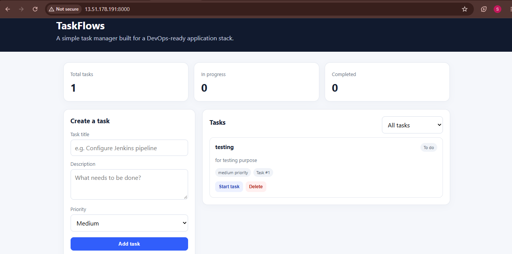

**FastAPI interactive API documentation**

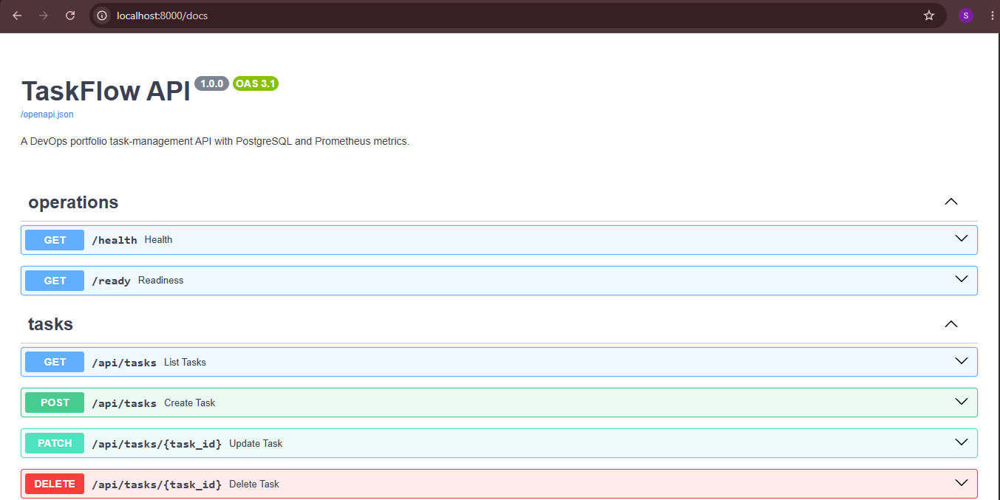

### Containers and monitoring

**Docker Compose services**

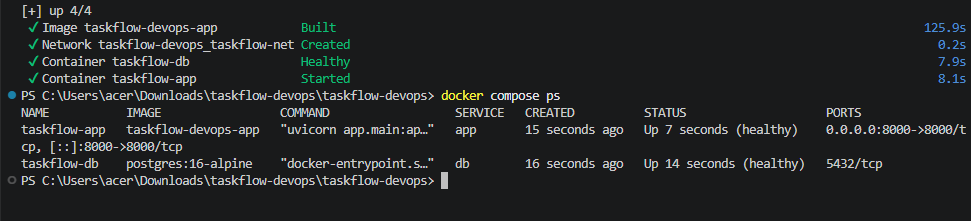

**Prometheus target discovery**

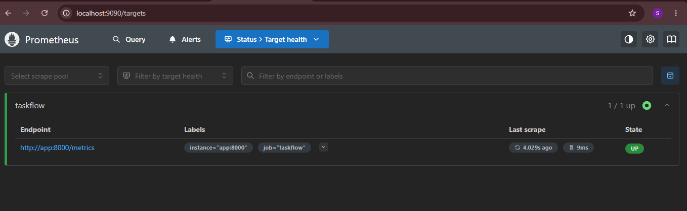

**Grafana dashboard and application metrics**

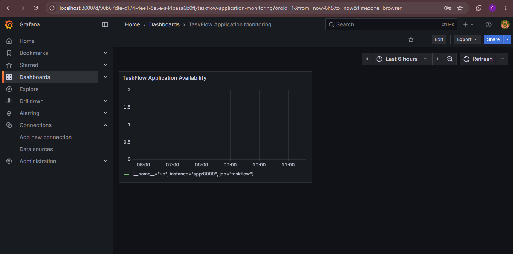

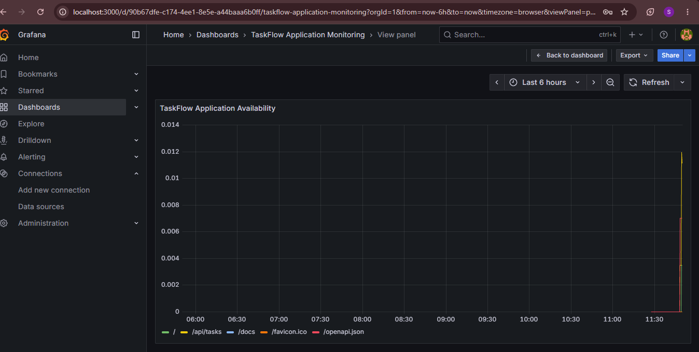

### CI/CD automation

**Jenkins pipeline execution**

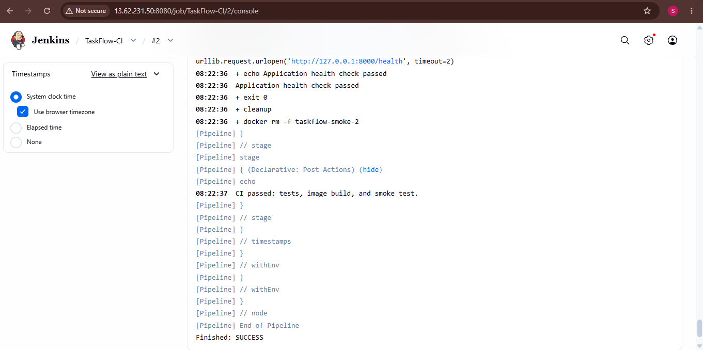

**GitHub webhook configuration**

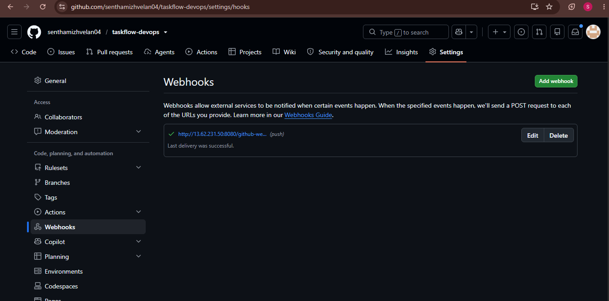

### Terraform and AWS infrastructure

**Terraform apply output**

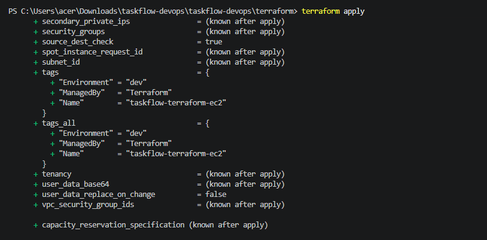

**AWS EC2 instance**

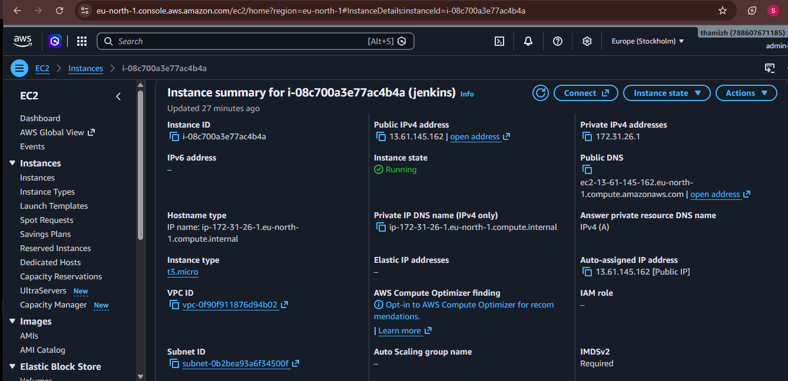

**Additional Terraform resource evidence**

<details>
<summary>View Terraform outputs and provisioned resources</summary>

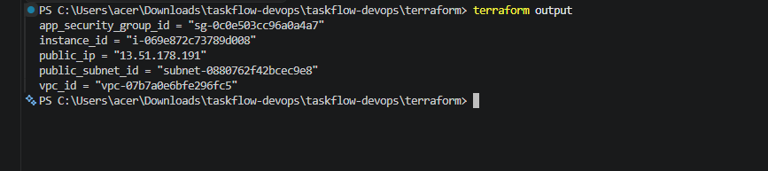

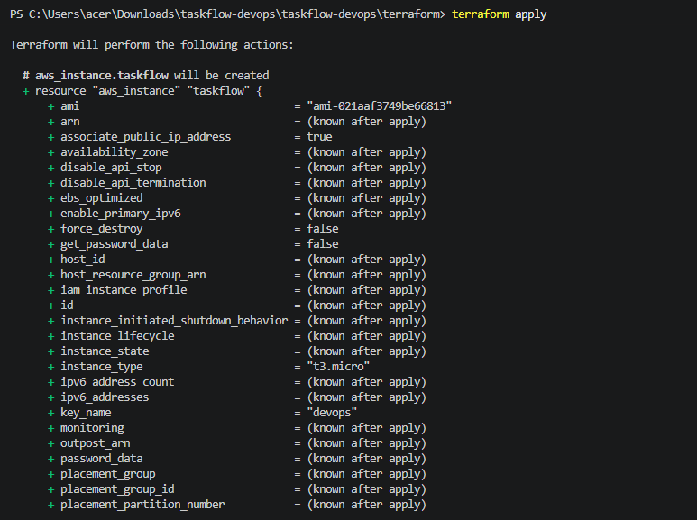

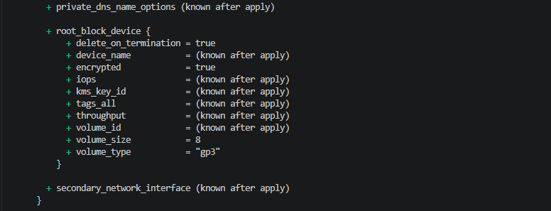

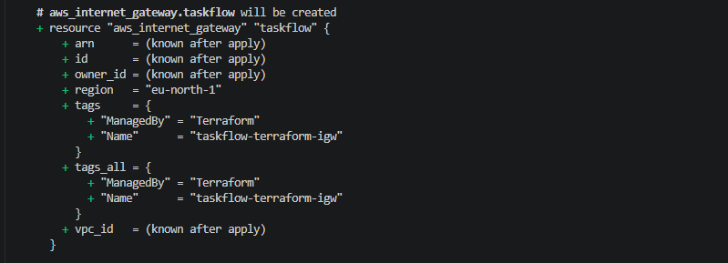

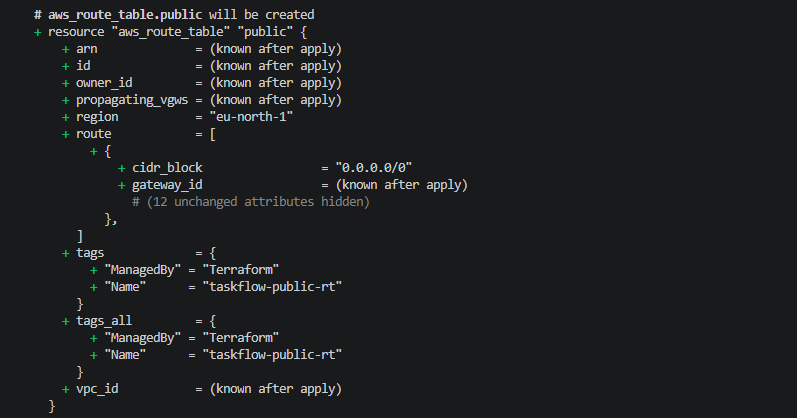

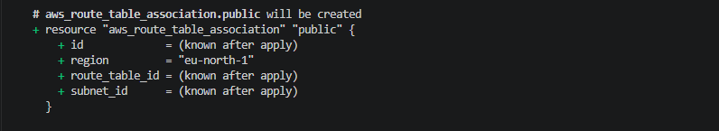

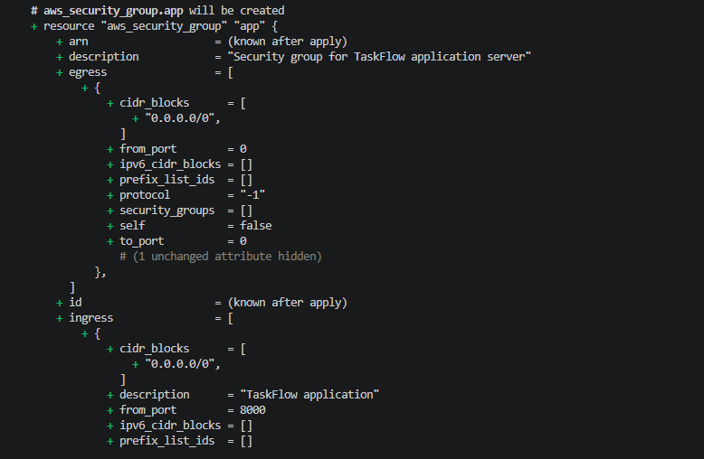

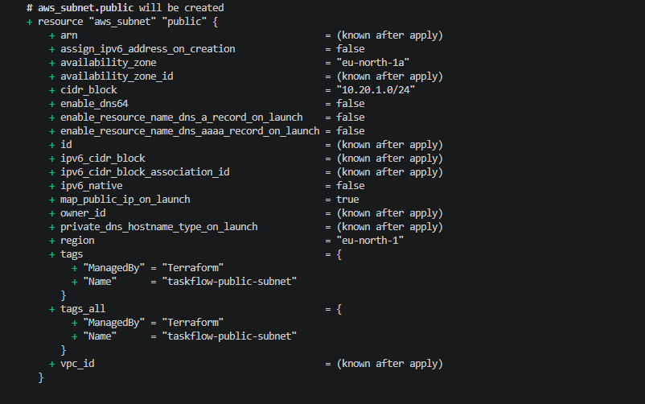

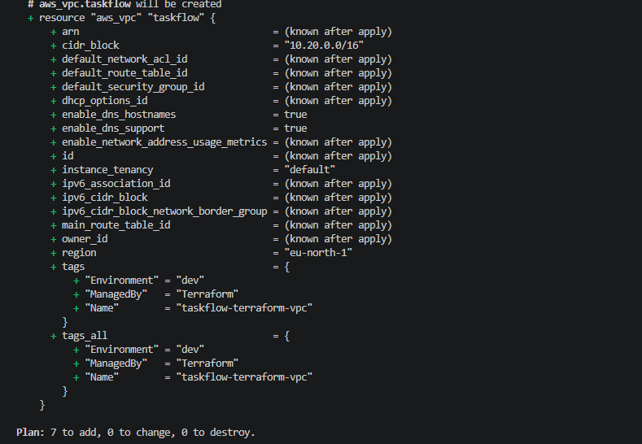

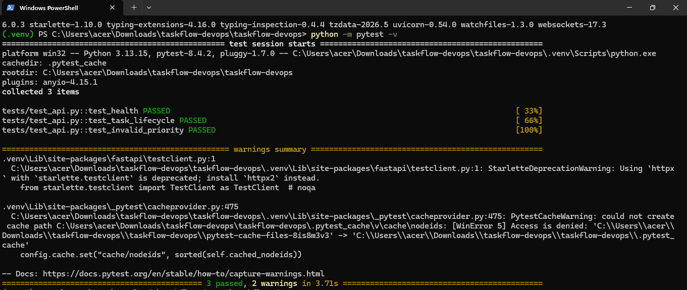

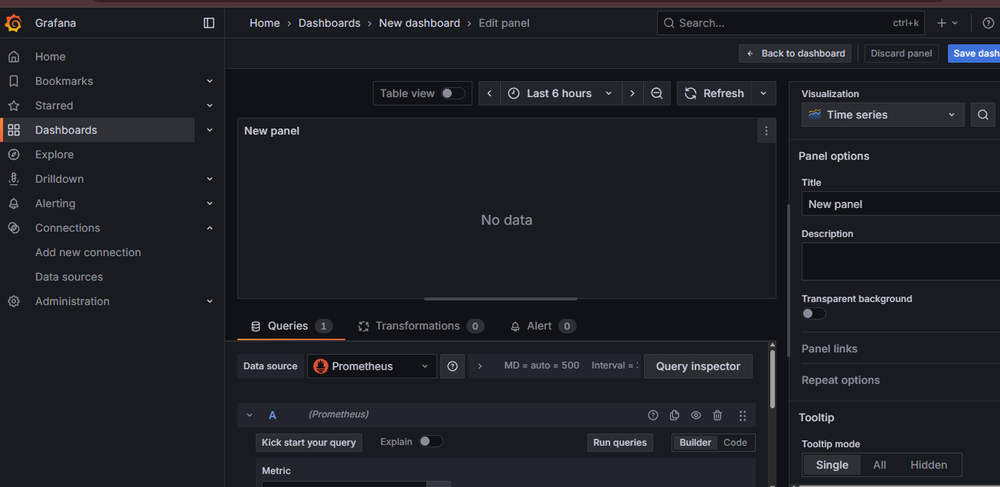

</details>

## Architecture

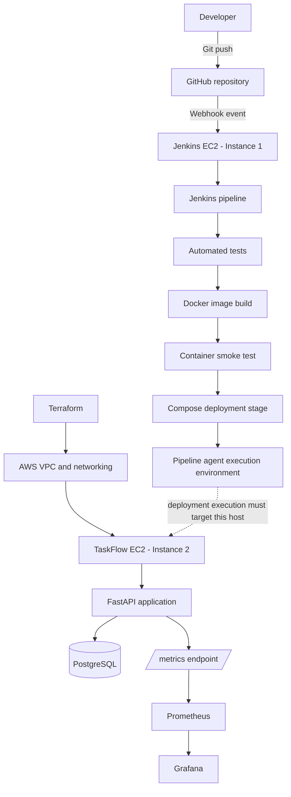

**Deployment execution note:** GitHub webhook delivery to Jenkins and the two-instance separation are part of the described setup. In the uploaded `Jenkinsfile`, the `Deploy Application` stage executes `docker compose` commands on the Jenkins pipeline agent; it does not contain an explicit SSH command. Therefore, the actual mechanism that makes this stage operate against the Terraform-managed EC2 depends on the Jenkins agent/execution configuration. This README does not claim that SSH deployment is implemented.

## Technology Stack

| Area | Tools / technologies |
|---|---|
| Cloud | AWS EC2, VPC, subnet, Internet Gateway, route table, security groups |
| Infrastructure as Code | Terraform |
| CI/CD | Jenkins, GitHub webhook |
| Application | Python 3.12, FastAPI, SQLAlchemy |
| Database | PostgreSQL 16 |
| Containers | Docker, Docker Compose |
| Monitoring | Prometheus, Grafana, Prometheus Python client |
| Testing | Pytest, FastAPI TestClient, SQLite test database |
| AI-assisted engineering | ChatGPT for development support, debugging, and troubleshooting |

## Application Features

- Create, list, update, and delete tasks.
- Filter tasks by status (`todo`, `in_progress`, `done`).
- Persist task data using PostgreSQL in the Compose environment.
- Serve a browser-based TaskFlow interface.
- Expose interactive API documentation through FastAPI.
- Provide health, readiness, and Prometheus metrics endpoints.

### API Endpoints

| Method | Endpoint | Purpose |
|---|---|---|
| GET | `/` | TaskFlow web interface |
| GET | `/api/tasks` | List tasks |
| GET | `/api/tasks?status=todo` | Filter tasks by status |
| POST | `/api/tasks` | Create a task |
| PATCH | `/api/tasks/{task_id}` | Update task fields |
| DELETE | `/api/tasks/{task_id}` | Delete a task |
| GET | `/health` | Application process health |
| GET | `/ready` | Database readiness check |
| GET | `/metrics` | Prometheus metrics endpoint |
| GET | `/docs` | Interactive API documentation |

### API Usage Examples

**Create a task:**

```bash
curl -X POST http://localhost:8000/api/tasks \
  -H "Content-Type: application/json" \
  -d '{"title": "Configure Jenkins pipeline", "description": "Set up CI/CD for TaskFlow", "priority": "high"}'
```

```json
{
  "id": 1,
  "title": "Configure Jenkins pipeline",
  "description": "Set up CI/CD for TaskFlow",
  "priority": "high",
  "status": "todo",
  "created_at": "2026-10-30T11:00:00+00:00"
}
```

**List all tasks:**

```bash
curl http://localhost:8000/api/tasks
```

**Filter tasks by status:**

```bash
curl http://localhost:8000/api/tasks?status=in_progress
```

**Update a task (partial update):**

```bash
curl -X PATCH http://localhost:8000/api/tasks/1 \
  -H "Content-Type: application/json" \
  -d '{"status": "in_progress"}'
```

```json
{
  "id": 1,
  "title": "Configure Jenkins pipeline",
  "description": "Set up CI/CD for TaskFlow",
  "priority": "high",
  "status": "in_progress",
  "created_at": "2026-10-30T11:00:00+00:00"
}
```

**Delete a task:**

```bash
curl -X DELETE http://localhost:8000/api/tasks/1
```

Returns `204 No Content` on success.

**Check application health:**

```bash
curl http://localhost:8000/health
```

```json
{
  "status": "healthy",
  "service": "taskflow-api"
}
```

**Check database readiness:**

```bash
curl http://localhost:8000/ready
```

```json
{
  "status": "ready",
  "database": "connected"
}
```

## AWS Infrastructure with Terraform

Terraform provisions a dedicated TaskFlow network and EC2 environment. The checked-in configuration defines:

- VPC CIDR: `10.20.0.0/16`.
- Public subnet CIDR: `10.20.1.0/24`.
- Internet Gateway and public route table.
- Route table association for the public subnet.
- Security group for application access and SSH administration.
- EC2 instance using a `t3.micro` instance type.
- Encrypted 8 GB `gp3` root EBS volume.

The configured region is `eu-north-1`, with the availability zone derived from the configured region. AMI, key pair, region, and allowed SSH source are provided through Terraform variables.

### Terraform Variables

| Variable | Description | Default | Required |
|---|---|---|---|
| `region` | AWS region for the TaskFlow environment | `eu-north-1` | No |
| `key_name` | Existing EC2 key pair name | `devops` | No |
| `ami` | AMI ID for the EC2 instance | `ami-021aaf3749be66813` | No |
| `my_ip` | Your public IPv4 address in CIDR notation (e.g. `203.0.113.50/32`) | — | **Yes** |

> **Note:** `my_ip` has no default value and must be provided. Without it, `terraform plan` will prompt for input or fail. You can supply it via a `terraform.tfvars` file (gitignored) or the `-var` flag.

### Terraform Workflow

```bash
cd terraform
terraform init
terraform fmt
terraform validate
terraform plan -var="my_ip=YOUR_PUBLIC_IP/32"
terraform apply -var="my_ip=YOUR_PUBLIC_IP/32"
terraform output
```

To remove resources created by this configuration:

```bash
terraform destroy -var="my_ip=YOUR_PUBLIC_IP/32"
```

Review the plan carefully before applying or destroying infrastructure. The current security group permits TCP port `8000` from `0.0.0.0/0`; this is convenient for the demo but should be restricted or placed behind a controlled ingress layer before production use.

## CI/CD with Jenkins and GitHub Webhooks

A GitHub webhook is configured to notify the Jenkins EC2 when repository changes are pushed. Jenkins receives the event and starts the pipeline.

The checked-in `Jenkinsfile` defines these stages:

| Stage | What it does |
|---|---|
| Checkout | Checks out the source and prints the short Git commit ID |
| Run Automated Tests | Installs development dependencies in a temporary Python 3.12 container and runs `pytest -v` |
| Build Docker Image | Builds `taskflow:${BUILD_NUMBER}` and tags the image as `taskflow:latest` |
| Container Smoke Test | Starts a temporary container and checks the `/health` endpoint, then removes the test container |
| Deploy Application | Runs Docker Compose with the monitoring profile and `/etc/taskflow/.env`, then waits for `taskflow-app` to become healthy |

The pipeline also enables timestamps and disables concurrent builds. It reports success or failure in the post-build section.

**Execution detail:** The deployment stage invokes Docker Compose on the pipeline agent. The Jenkinsfile itself does not define SSH transport to another host. The pipeline agent must therefore be configured appropriately for the deployment target. Keep this distinction clear when describing the deployment topology.

## Docker and Docker Compose

The Dockerfile uses `python:3.12-slim`, installs application dependencies, copies the FastAPI application, creates and switches to a non-root `app` user, and starts Uvicorn on port `8000`.

The Compose configuration defines:

| Service | Role | Port |
|---|---|---|
| `app` | FastAPI application container | `8000` (public) |
| `db` | PostgreSQL 16 database | Internal only |
| `prometheus` | Optional metrics collection service | `127.0.0.1:9090` |
| `grafana` | Optional monitoring dashboard service | `127.0.0.1:3000` |

The application waits for PostgreSQL's health check. The app has a readiness health check, and named volumes preserve PostgreSQL, Prometheus, and Grafana data across container recreation. Prometheus and Grafana are enabled with the `monitoring` Compose profile and their host ports bind to localhost (`127.0.0.1`).

## Monitoring and Observability

The application exposes `/metrics` using the Prometheus Python client. The code defines:

- `taskflow_http_requests_total` — request count, labelled by method, endpoint, and status code.
- `taskflow_http_request_duration_seconds` — request duration histogram, labelled by method and endpoint.

Prometheus is configured to scrape the application metrics endpoint every 15 seconds. Grafana is configured with a provisioned Prometheus data source. The screenshots above show the monitoring configuration and dashboard evidence.

## Testing

Tests are implemented with Pytest and FastAPI's TestClient. The test suite uses a separate SQLite database configuration to ensure isolation from the PostgreSQL production database.

The test suite covers:

| Test | What it validates |
|---|---|
| `test_health` | `/health` returns `200` with `{"status": "healthy"}` |
| `test_task_lifecycle` | Full CRUD: create → update status → list → delete → verify removal |
| `test_invalid_priority` | Invalid priority value `"urgent"` returns `422` (Pydantic validation) |

Run locally:

```bash
pip install -r requirements-dev.txt
pytest -v
```

The Jenkins pipeline runs tests in a disposable `python:3.12-slim` container before building the application image.

## Run Locally with Docker Compose

### Prerequisites

| Tool | Minimum Version | Purpose |
|---|---|---|
| [Git](https://git-scm.com/) | 2.30+ | Clone the repository |
| [Docker Engine](https://docs.docker.com/engine/install/) | 20.10+ | Build and run containers |
| [Docker Compose](https://docs.docker.com/compose/install/) | v2.0+ (Compose plugin) | Orchestrate multi-container services |

### 1. Clone the repository

```bash
git clone https://github.com/senthamizhvelan04/taskflow-devops.git
cd taskflow-devops
```

### 2. Create `.env`

Copy the example environment file and update the passwords:

```bash
cp .env.example .env
```

Then edit `.env` and replace the placeholder values with strong passwords:

```env
POSTGRES_PASSWORD=replace_with_a_strong_password
GRAFANA_PASSWORD=replace_with_a_strong_password
```

> **Warning:** Do not commit `.env` or real credentials. The `.gitignore` is already configured to exclude `.env` files.

### 3. Start the application and database

```bash
docker compose up -d --build app db
docker compose ps
```

### 4. Start monitoring (optional)

```bash
docker compose --profile monitoring up -d
```

### 5. Open the application

| Service | URL | Notes |
|---|---|---|
| Application | http://localhost:8000 | TaskFlow web interface |
| API documentation | http://localhost:8000/docs | Interactive Swagger UI |
| Health check | http://localhost:8000/health | Application liveness |
| Readiness check | http://localhost:8000/ready | Database connectivity |
| Metrics | http://localhost:8000/metrics | Prometheus scrape endpoint |
| Prometheus | http://localhost:9090 | Host-local binding; requires monitoring profile |
| Grafana | http://localhost:3000 | Username: `admin`, password: your `GRAFANA_PASSWORD` |

### 6. Stop the stack

To stop while preserving named volumes:

```bash
docker compose --profile monitoring down
```

To also delete persistent database and monitoring data, use `docker compose --profile monitoring down -v`. This is destructive.

## AI-Assisted Engineering

ChatGPT was used as an engineering assistant during development for learning and troubleshooting AWS, Terraform, Docker, Jenkins, Linux, and CI/CD concepts; debugging configuration and deployment issues; and improving technical documentation. **TaskFlow does not currently contain an integrated AI-powered application feature.** AI usage in this project refers to the development workflow, not runtime application functionality.

## Repository Structure

```text
taskflow-devops/
├── app/
│   ├── static/
│   │   └── index.html          # Single-page frontend (vanilla JS)
│   ├── __init__.py
│   ├── database.py             # SQLAlchemy engine and session factory
│   ├── main.py                 # FastAPI app, routes, middleware, metrics
│   ├── models.py               # Task ORM model
│   └── schemas.py              # Pydantic request/response schemas
├── monitoring/
│   ├── grafana-datasource.yml  # Provisioned Prometheus data source
│   └── prometheus.yml          # Scrape configuration
├── screenshots/                # Project implementation evidence
├── terraform/
│   ├── ec2.tf                  # EC2 instance definition
│   ├── main.tf                 # VPC, subnet, IGW, routes, security group
│   ├── outputs.tf              # Exported resource identifiers
│   ├── provider.tf             # AWS provider configuration
│   └── variable.tf             # Input variables
├── tests/
│   └── test_api.py             # Pytest API test suite
├── .env.example                # Template for required environment variables
├── .gitignore
├── Dockerfile                  # Python 3.12-slim, non-root user
├── Jenkinsfile                 # 5-stage declarative pipeline
├── compose.yaml                # App, DB, Prometheus, Grafana
├── requirements.txt            # Production dependencies
└── requirements-dev.txt        # Test dependencies (pytest, httpx)
```

## Security Notes and Current Limitations

This is a portfolio and learning project, not a production-hardened service. The current implementation has the following known limitations:

- No application authentication or authorization.
- Database tables are created at application startup; a migration tool such as Alembic is not yet configured.
- Automated database backup and restore are not included.
- Application port `8000` is currently open to the internet in the Terraform security group.
- The project does not yet demonstrate a verified deployment rollback process.
- Production TLS/reverse-proxy configuration and centralized logging are not included.

Before production use, add authentication, migrations, managed secrets, restricted network access, TLS, backups and restore testing, image vulnerability scanning, least-privilege IAM, and a tested rollback strategy.

## Potential Next Improvements

- Publish immutable image tags to a container registry.
- Add container image vulnerability scanning to CI.
- Add deployment rollback and release verification.
- Add Prometheus alert rules and notification routing.
- Add centralized logs and database backup automation.
- Improve Terraform modularity and remote state management.
- Add HTTPS and a reverse proxy, and restrict public ingress.

## Author

**Senthamizhvelan**  
GitHub: [@senthamizhvelan04](https://github.com/senthamizhvelan04)  
Repository: [taskflow-devops](https://github.com/senthamizhvelan04/taskflow-devops)

---

*Built as a hands-on Cloud and DevOps engineering portfolio project.*
